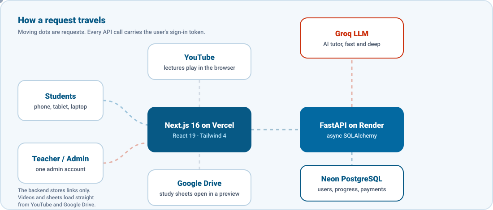
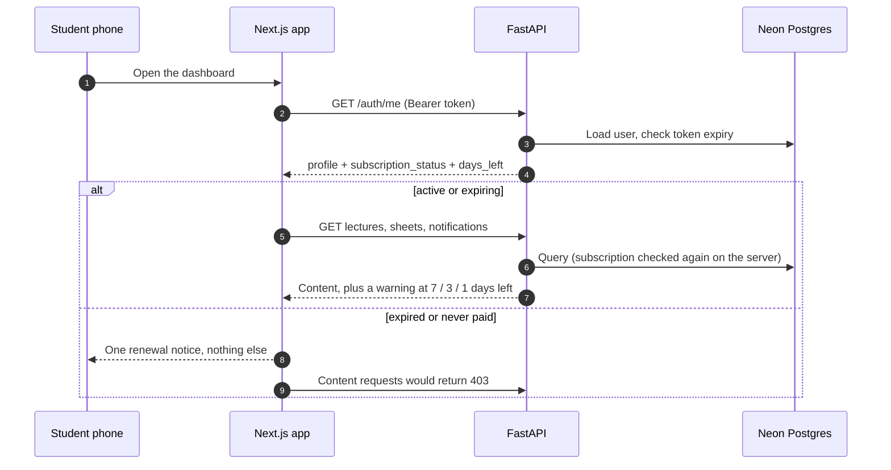
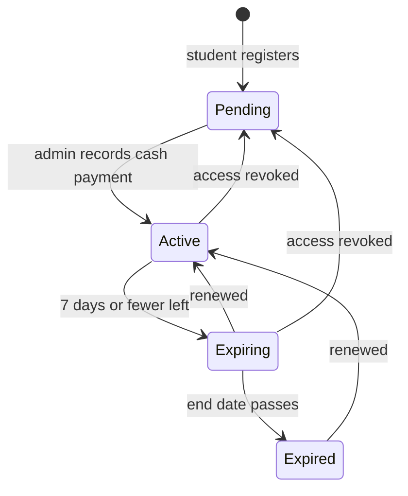

<div align="center">



<br/>

<a href="https://azs-the-catalyst.vercel.app/"></a>


</div>

<br/>

## Mission control

A teacher runs a coaching batch. Students need lectures, notes, a study plan and someone to answer questions at 11 pm. The teacher collects fees in cash and needs to know, at a glance, who has paid. AZS is one system that does all of it, and it is built for the phone in the student's hand.

<div align="center">

</div>

<br/>

> The console above is a visual for the README, not a live terminal. The modules it lists are real parts of the code, described in [The crew](#the-crew).

---

## What you can do

<details open>
<summary><b>As a student</b></summary>

<br/>

| | |
|---|---|
| **Learn** | Watch YouTube lectures grouped by subject and chapter, resume exactly where you stopped, and open study sheets from Google Drive in a preview. |
| **Track** | Daily streak, weekly goal, course coverage, XP, levels and badges. Progress syncs to the server and keeps working through a flaky connection by queueing changes on the phone. |
| **Plan** | A study calendar with your own tasks and automatic revision reminders, plus personal notes on every lecture. |
| **Ask** | An AI tutor with a fast mode and a deep mode, saved chat history, and answers that render maths (KaTeX) and tables properly. |
| **Play** | A practice lab with four interactive simulations: Projectile Motion, Bohr Atom, Molecule Shapes and a pH Scale. |
| **Stay informed** | The teacher's notice, plus in-app renewal warnings when a subscription has 7, 3 and 1 days left. |

</details>

<details>
<summary><b>As the teacher (admin)</b></summary>

<br/>

| | |
|---|---|
| **See the whole batch** | An overview with a stacked subscription bar (active, expiring, expired, not paid), a list of students who need attention, a per-batch breakdown, content counts, AI usage and cash recorded this month. |
| **Open any student** | Tap a name to see their progress by subject and chapter, streak, last 28 days of activity, recent lectures and payment history. |
| **Handle cash** | Record a payment (30, 60, 90 days or custom), with an optional amount and note. It is logged, double taps are blocked, the latest payment can be undone, and access can be revoked. |
| **Publish content** | Add lectures (YouTube links) and study sheets (Google Drive links), reorder lectures, hide or show items, and post notices. |

</details>

<details>
<summary><b>What an unpaid student sees</b></summary>

<br/>

One calm renewal notice in Bangla and nothing else: no lectures, no sheets, no AI tutor. A button opens WhatsApp to the teacher and another re-checks the account after the cash is handed over. The check runs on the server, so it holds even if someone calls the API directly.

</details>

---

## How it fits together

<div align="center">

</div>

<br/>

<details>
<summary><b>Follow one request through the gate</b></summary>

<br/>



</details>

<details>
<summary><b>Subscription lifecycle</b></summary>

<br/>



Renewing extends from the current end date if the plan is still running, otherwise from today. Undoing the latest payment restores the previous end date.

</details>

---

## The crew

Each part of the backend has one job. Nothing here acts on its own: everything runs when a request arrives.

| Module | Job | Where it lives |
|---|---|---|
| **Gatekeeper** | Decides who may do what: admin-only routes, subscriber-only content, token expiry, login throttling. | `backend/app/core/access.py` |
| **Ledger** | Cash renewals, payment history, double-tap guard, undo. | `backend/app/services/subscription.py` |
| **Messenger** | Creates in-app warnings at 7, 3 and 1 days left, and notes for expiry and renewal, once each. | `backend/app/api/v1/notifications.py` |
| **Tracker** | Per-student progress, streaks and the admin's progress view. | `backend/app/services/student_progress.py`, `backend/app/api/v1/progress.py` |
| **Tutor** | Chooses a model, keeps the tutor on syllabus topics, rate limits, calls the provider. | `backend/app/services/ai_tutor.py` |
| **Link keeper** | Accepts only YouTube lecture links and Google Drive sheet links, and cleans them. | `backend/app/services/links.py` |

> **Heads up on notifications.** Warnings are created and shown inside the app when the student opens it. There is no email or SMS yet, so a student who never opens the app will not see one.

---

## Security, in plain words

- The admin is one account: the email in `ADMIN_EMAIL`, an admin flag, or an admin role. Every admin route checks it on the server.
- Lectures, sheets and the AI tutor require an active subscription, checked on the server for every request.
- Tokens expire. The signing key comes from `SECRET_KEY`; a key that is too short or that is a known published default is refused.
- Ten wrong passwords in ten minutes pauses logins for that email and address.
- Server errors return a generic message to the caller and keep the detail in the server log.
- Dates are normalised to UTC when they are read from the database, so the app behaves the same whichever timestamp type a column uses.

---

## Tech stack

| Layer | What it uses |
|---|---|
| **Frontend** | Next.js 16 (App Router), React 19, TypeScript, Tailwind CSS 4, Framer Motion, Three.js with React Three Fiber on the landing page, lucide-react icons |
| **AI answers** | react-markdown with KaTeX for maths and tables |
| **Backend** | FastAPI, async SQLAlchemy 2, asyncpg, Pydantic 2, python-jose (JWT), passlib with bcrypt |
| **Database** | PostgreSQL (Neon) |
| **AI** | Groq's OpenAI-compatible API, with models you can change by environment variable |
| **Hosting** | Vercel for the frontend, Render for the backend |

---

## Project map

```text
AZS-The-Catalyst/
├── frontend/
│   └── src/
│       ├── app/                  landing, login, register, dashboard, admin
│       ├── components/
│       │   ├── admin/            overview, students, progress drawer, lectures, sheets, notices
│       │   ├── dashboard/        cards, player, calendar, locked screen, notification banner
│       │   └── landing/          hero, simulations
│       ├── hooks/                dashboard data, progress sync, notifications
│       └── lib/                  API client, progress logic, simulations
├── backend/
│   ├── app/
│   │   ├── api/v1/               auth, academic, admin, chat, progress, notifications
│   │   ├── core/                 config, access control, database, column types
│   │   ├── models/               users, content, chat, progress, billing
│   │   └── services/             subscription, progress, tutor, links, throttle
│   └── tests/                    pytest suite
├── docs/assets/                  the animated SVGs used in this README
└── docker-compose.yml
```

---

## Run it on your machine

You need Node.js 20 or newer, Python 3.11 or newer, and a PostgreSQL database that accepts SSL connections. A free [Neon](https://neon.tech) database works well.

> **Why not the local Postgres in `docker-compose.yml`?** The backend connects with SSL required, which a plain local Postgres container does not offer. Use a Neon database for development.

**1. Backend**

```bash
cd backend
python -m venv .venv
source .venv/bin/activate            # Windows: .venv\Scripts\activate
pip install -r requirements.txt

cp ../.env.example ../.env           # then edit ../.env (see the table below)
uvicorn app.main:app --reload --port 8000 --env-file ../.env
```

The tables are created on the first start.

**2. Frontend**

```bash
cd frontend
npm install
echo "NEXT_PUBLIC_API_URL=http://localhost:8000" > .env.local
npm run dev
```

Open <http://localhost:3000>.

**3. Make yourself the admin**

Register on the sign-up page with the email you set as `ADMIN_EMAIL` (the default is `rabbi@edutrack.com`). That account opens the admin panel at `/admin`. Every other account is a student and starts locked until you record a payment.

### Settings

| Variable | Needed | What it does |
|---|---|---|
| `DATABASE_URL` | yes | PostgreSQL connection string. `postgresql://` is converted to the asyncpg form for you. |
| `SECRET_KEY` | yes in production | Long random string that signs login tokens. If it is missing, a key is derived from `DATABASE_URL` so sessions survive restarts, which is safe enough for development only. |
| `ADMIN_EMAIL` | no | The one admin address. Default `rabbi@edutrack.com`. |
| `GROQ_API_KEY` | for the AI tutor | API key from the provider. `AI_API_KEY` also works. |
| `AI_MODEL_DEEP`, `AI_MODEL_FAST` | no | Models behind the deep and fast buttons. |
| `AI_API_URL` | no | Another OpenAI-compatible chat endpoint. |
| `NEXT_PUBLIC_API_URL` | frontend | Where the backend lives. |

### Run the tests

```bash
cd backend
pip install pytest pytest-asyncio aiosqlite
pytest -q
```

The tests run on SQLite. A few behaviours, such as timezone-aware timestamps, only show up on PostgreSQL, so they are covered by unit tests on the column type instead.

---

## Deploying

| Part | Service | Notes |
|---|---|---|
| Frontend | Vercel | Set `NEXT_PUBLIC_API_URL` to the backend address. |
| Backend | Render | Set `DATABASE_URL`, `SECRET_KEY`, `ADMIN_EMAIL` and `GROQ_API_KEY`. On the free plan the service sleeps when idle, so the first request after a quiet period can take a minute. |
| Database | Neon | The free tier is enough for a pilot. |

After changing `SECRET_KEY`, everyone is signed out once. That is expected.

---

## Roadmap

Nothing here is promised. These are the next ideas, in the order they would pay off.

- [ ] Email or WhatsApp renewal reminders for students who do not open the app
- [ ] Marks tracker for the coaching's own class tests
- [ ] Chapter-wise MCQ practice with weak-topic tracking
- [ ] A way for the teacher to send a personal message to one student

---

## People

**Built by** [Mir Mohammad Sajedul Islam](https://sajedulislam5840.github.io/portfolio/), platform architect and lead developer. [GitHub](https://github.com/sajedulislam5840) · [LinkedIn](https://www.linkedin.com/in/sajedul-islam-data/)


## License

Released under the [MIT License](LICENSE).

<div align="center">
<br/>
<sub>Made for students who study on their phones.</sub>
</div>
